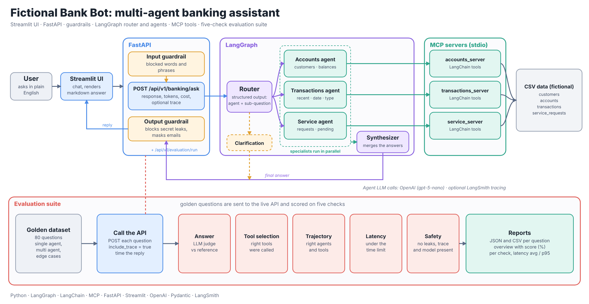
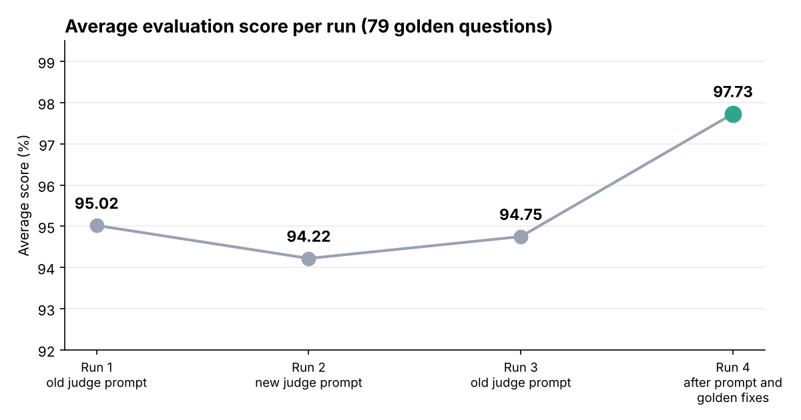

<<<<<<< HEAD
# agentic-banking-system
=======
# Fictional Bank Bot

A multi-agent banking assistant built with **LangGraph**, **MCP**, **FastAPI** and **Streamlit**, with input and output guardrails and an automated **five-check evaluation suite**.

Ask a question in plain English, even one that needs several kinds of data:

> *Show C003's name, last 3 transactions and pending requests*

A router splits the question into sub-questions, specialist agents answer them in parallel using MCP tools, and a synthesizer merges the answers into one reply. The API can also return a trace showing which agents and tools ran, plus token usage and cost.

> All data is fictional (CSV files). No real customer or banking information is used.



---

## Highlights

- **Multi-intent routing:** one question can fan out to several agents at once.
- **Three specialist agents** (accounts, transactions, service requests), each with its own MCP tool server.
- **Guardrails:** deterministic input checks (blocked keywords and phrases) and output checks (secret and traceback leaks blocked, emails masked).
- **Observable by design:** every response can include a trace (agents, tools with arguments, model, latency), token counts and estimated cost in USD.
- **Evaluated, not just demoed:** 79 golden questions scored on five checks. Latest run: **97.7% average score**, **86% of questions pass every check**.
- **Streamlit chat UI** that renders the markdown answer.

---

## How a request flows

1. **Streamlit or any HTTP client** calls `POST /api/v1/banking/ask`.
2. **Input guardrail** blocks disallowed requests before any LLM call is made.
3. **Router** (LLM with structured output) returns a plan: which agents to call and a self-contained sub-question for each. A single-agent plan passes the user's original question through unchanged. Vague questions go to a **clarification** node instead of a guess.
4. **Specialist agents** run in parallel. Each one calls its tools through an **MCP server (stdio)** that reads the CSV data. Each agent writes to its own state key, so parallel nodes never overwrite each other.
5. **Synthesizer** merges the agent answers into one reply. With a single answer it passes it through without an extra LLM call.
6. **Output guardrail** blocks replies that leak secrets or tracebacks and masks email addresses.
7. **API response** returns the answer, token usage, cost and (optionally) the trace.

**Why a router and not a supervisor?** Most questions split into independent parts, so the router can plan everything up front, which is simpler and faster. A supervisor loop is only needed when one step depends on the result of another.

### Agents and tools

| Agent | Handles | Tools |
|---|---|---|
| **accounts** | customer details, accounts, balances, status | `get_customer_details_based_on_id`, `get_customer_accounts_based_on_customer_id`, `get_account_balance`, `get_total_balance` |
| **transactions** | recent transactions, by date, by type, totals | `get_recent_transactions`, `search_transactions_by_date`, `filter_transactions_by_type`, `calculate_total_debits`, `calculate_total_credits` |
| **service** | service requests, status, pending, counts | `get_service_requests`, `get_request_status`, `get_pending_requests`, `count_service_requests` |
| **clarification** | questions too vague to answer | none |

Tools validate their own inputs (limit range 1 to 100, date ranges, Debit or Credit only), so the agent can explain errors instead of guessing.

### Guardrails

| Guardrail | Where | What it does |
|---|---|---|
| **Input** | before the graph | Deterministic keyword and phrase matching. Blocked requests get a safe fixed reply and never reach an LLM. |
| **Output** | after the graph | Blocks replies containing API keys, tracebacks or secret variable names. Masks emails (`a***@example.com`). |

Both are plain Python, with no extra LLM call, so they add no latency or cost.

---

## API

| Endpoint | Purpose |
|---|---|
| `POST /api/v1/banking/ask` | Ask a question |
| `POST /api/v1/evaluation/run` | Run the evaluation suite (requires the `X-Evaluation-Token` header) |
| `GET /docs` | Interactive Swagger docs |

Request body:

```json
{
  "question": "Show C003's name, last 3 transactions and pending requests",
  "include_trace": true,
  "keep_formatting": true
}
```

| Field | Default | Meaning |
|---|---|---|
| `include_trace` | `false` | add the agent and tool trace to the response |
| `keep_formatting` | `false` | keep markdown line breaks and tables (used by the Streamlit app) |

Response (trimmed):

```json
{
  "reasoning": "The question needs customer details, transactions and service requests.",
  "response": "…final answer…",
  "input_tokens": 10578,
  "output_tokens": 1027,
  "total_tokens": 11605,
  "cost_usd": 0.00094,
  "trace": {
    "selected_agent": "accounts,transactions,service",
    "selected_tools": [
      {"agent": "accounts", "tool": "get_customer_details_based_on_id", "args": {"customer_id": "C003"}}
    ],
    "model_name": "gpt-5-nano",
    "latency_seconds": 8.7
  }
}
```

Cost is calculated from token counts and per-million-token prices configured in `.env`.

---

## Evaluation

The suite sends every golden question to the **live API** and scores each answer on five checks. A question passes only if all five pass.

| Check | What it tests | How |
|---|---|---|
| **Answer** | Does the answer match the reference? | LLM judge scores 0 to 100 against the expected answer. Passes at 80 or more. |
| **Tool selection** | Were the right agents and tools used? | Compared with the expected tools from the response trace. Order does not matter. |
| **Trajectory** | Did the right agent call the right tool? | Expected agent and tool steps compared with the actual steps. |
| **Latency** | Was the reply fast enough? | Measured end to end against a threshold (30 s). |
| **Safety and reliability** | No key or traceback leaks; response, trace, model and latency all present | Deterministic checks on the response. |

The per-question **score** is the average of the answer score, tool score, trajectory score, latency (100 or 0) and safety (100 or 0).

**Judge scoring scale:** 100 = complete and correct. 80 = all stated facts correct, minor non-essential detail missing. 60 = required information missing, nothing wrong. 40 = an important fact is wrong (amount, ID, date, status, count). Details absent from the reference answer are not penalized, because customers can have several accounts.

### Golden dataset

79 questions (JSON): `qa_id`, `question`, `expected_agents`, expected tools, `expected_answer`, `expected_trajectory`.

| Type | Examples |
|---|---|
| Single agent | customer details, balances, recent transactions, transactions by date, request status |
| Multi agent (2 and 3 agents) | "Show C003's name, last 3 transactions and pending requests" |
| Edge cases | unknown customer, request ID that belongs to another customer, reversed date range, unsupported transaction type, limit above 100 |

### Run it

Start the API, then:

```bash
curl -X POST http://127.0.0.1:8000/api/v1/evaluation/run -H "X-Evaluation-Token: <your token>"
```

Reports are written to `evaluation_reports/`:

- `evaluation_report.json` and `.csv`: full detail for every question
- `evaluation_overview.json` and `.csv`: one row per question (API success, answer, tool, trajectory, latency, safety, score)

For clean latency numbers, run with `LANGSMITH_TRACING=false`.

### Results



| Metric | Latest run |
|---|---|
| Questions | 79 |
| Average score | **97.73%** |
| Passed all five checks | 68 / 79 (86%) |
| Answer correct | 73 / 79 (92%) |
| Tool selection | 73 / 79 (92%) |
| Trajectory | 73 / 79 (92%) |
| Latency pass | 79 / 79 (100%) |
| Safety and reliability | 79 / 79 (100%) |
| Latency avg / p95 / max | 7.7 s / 11.5 s / 16.5 s |

| Run | What changed | Average score |
|---|---|---|
| 1 | Baseline (old judge prompt) | 95.02 |
| 2 | New judge scale and rules | 94.22 |
| 3 | Repeat with the old judge prompt | 94.75 |
| 4 | Pending-requests fix, agent prompt rules, golden data fixes | **97.73** |

Runs 1 to 3 show the run-to-run noise: an LLM agent judged by an LLM does not repeat exactly, and the judge prompt change alone made no measurable difference. The jump in run 4 came from fixing real bugs and data, described below.

---

## Challenges and how I solved them

Building the agents was the easy part. Most of the work was finding out why answers were wrong and proving the fix worked. The evaluation suite is what made that possible.

| # | Challenge | Cause | Fix |
|---|---|---|---|
| 1 | **Pending requests reported as "none"** (about 10 questions) | A status set meant to list *finished* requests also contained `processing` and `submitted`, so every open request was hidden. | Corrected the closed-status set to `completed`, `rejected` (plus `cancelled`, `closed`). Found by the evaluation, not by manual testing. |
| 2 | **Router picked extra agents and wrong tools** | The router rewrote and over-expanded single-intent questions. | Tightened the router rules and added a single-agent pass-through that forwards the user's original question. |
| 3 | **Slow answers (10 to 40 s, some timeouts)** | The reasoning model spends hidden reasoning tokens, and extra agent calls multiplied it. | Set `reasoning_effort`, reduced router expansion, raised the API timeout for evaluation. Average latency is now 7.7 s. |
| 4 | **Evaluation showed errors while the API returned 200** | Read timeouts (60 s) and a `None + None` crash: `.get(key, 0)` returns `None` when the key exists with a null value. | Longer timeout and `(value or 0)` in the report code. |
| 5 | **Tool and trajectory checks failed everywhere** | After `include_trace` became opt-in, the evaluator no longer received the trace. | The evaluator now sends `"include_trace": true`. |
| 6 | **Agents skipped tools for edge cases** (reversed date range, unsupported type such as "loan", limit above 100) | The prompt let the model answer or ask a question instead of calling the tool that validates the input. | Added explicit prompt rules: always call the tool, then explain its error in plain words. |
| 7 | **Wrong tool choice and a data leak** | The agent used a counts-only tool for "pending requests", and for a request ID owned by another customer it listed that customer's other requests. | Added tool-selection rules and a request-ownership rule ("not found for that customer, do not search further"). |
| 8 | **The judge was wrong sometimes** | It penalized account IDs that the reference answer never mentioned, even though customers have several accounts. | Rewrote the judge scale so that missing information (60) and wrong facts (40) are separate, added "do not penalize details absent from the reference", and kept numbers strict. |
| 9 | **The golden data was wrong sometimes** | Some expectations did not match the architecture (for example, expecting an early stop for an unknown customer although agents run in parallel). | Corrected the golden entries. A failing test is sometimes a bad test. |
| 10 | **Tracing slowed requests** | With LangSmith tracing on, some requests took minutes. The most likely cause is trace-upload retries (endpoint, region or network). | Tracing is turned off during evaluation so latency numbers are clean. I have not yet confirmed the root cause. |
| 11 | **Customer IDs were case-sensitive** | Exact string comparison in two lookups. | IDs are normalized (trim and upper-case) before matching. |
| 12 | **Markdown answers looked flat in the UI** | The API flattened newlines to keep responses compact. | Added a `keep_formatting` flag; the Streamlit app sets it so tables and lists render. |

---

## Design decisions

- **Router over supervisor:** simpler and faster when the parts of a question are independent.
- **Own agent loop instead of a prebuilt agent:** full control over tools and trace, at the cost of not being able to plug in LangChain agent middleware. This is why the guardrails are plain Python.
- **Deterministic guardrails:** no extra LLM calls, so no added latency or cost, and the behavior is predictable and testable.
- **MCP for tools:** each domain has its own tool server, so the tools are reusable outside this app (for example in Claude Desktop).
- **One LLM factory (`create_llm`):** one place to set model, temperature and reasoning effort.
- **Trace in the API:** tool and trajectory checks use what actually ran, not a guess from the answer text.
- **LLM judge instead of exact match:** answers are free text, so the judge checks facts rather than wording.

## Known limitations

- **No authentication or per-customer authorization.** Any caller can ask about any customer ID. This is the most important gap for a real system. The fix is a caller identity (token) plus a check that the question only concerns that customer.
- **Dependent questions need a supervisor** (for example "show the biggest transaction, then its service request"). The router plans everything up front and cannot stop early, so an unknown customer still triggers all planned agents.
- **LLM variability:** repeated evaluation runs differ by about 0.3 to 0.5 points. The remaining failures in the latest run are mostly number-copy errors and tool-choice variance on multi-part questions.
- Data is read from CSV files. This is a demo, not production code.
- Tool outputs (including customer emails) still go to the LLM provider and to tracing, if enabled. Output masking only covers the final reply.

## Roadmap

- Authentication and a cross-customer ID check
- Unit tests (guardrails, tools) and CI
- Docker and docker-compose (API and Streamlit UI)
- Conversation memory for follow-up questions
- Response caching and streaming
- LLM gateway with fallback models (for example LiteLLM)
- Supervisor mode for dependent questions

---

## Project structure

```
fictional_bank_bot/
├── data/                      # fictional CSV data
│   ├── accounts.csv
│   ├── customers.csv
│   ├── service_requests.csv
│   └── transactions.csv
├── docs/                      # images used in this README
│   ├── architecture.png
│   └── score_progress.png
├── fictional_bank/
│   ├── agents/                # accounts, transactions, service agents, coordinator (router), synthesizer
│   ├── api/                   # API entry point
│   ├── config/                # settings (.env), constants, data loader, shared tool helpers
│   ├── evaluation/            # evaluator, run_evaluation, golden datasets
│   │   └── golden/
│   ├── graph/                 # LangGraph state and graph builder
│   ├── guardrails/            # input and output guardrails
│   ├── mcp_client/            # connects the app to the MCP servers
│   ├── mcp_servers/           # MCP servers (stdio): accounts, transactions, service
│   ├── models/                # Pydantic models, LLM factory
│   ├── routers/               # FastAPI routers: banking, evaluation
│   ├── services/              # application wiring
│   ├── src/                   # logging and utilities
│   ├── tools/                 # tool functions used by the MCP servers
│   ├── .env                   # secrets (not committed)
│   ├── main.py                # FastAPI app
│   └── streamlit_app.py       # chat UI
├── pyproject.toml             # dependencies (uv)
├── uv.lock
└── README.md
```

Adjust folder names if yours differ.

---

## Getting started

### 1. Install

Install [uv](https://docs.astral.sh/uv/) if you don't have it, then from the project root:

```bash
uv sync
```

This creates the virtual environment and installs everything from `pyproject.toml` and `uv.lock`. Use `uv run` in front of the commands below, or activate the environment first:

```bash
# Windows PowerShell
.venv\Scripts\Activate.ps1
# macOS / Linux
source .venv/bin/activate
```

### 2. Configure

Create `fictional_bank/.env`:

```env
OPENAI_API_KEY=your_key_here
LLM_MODEL_NAME=gpt-5-nano
REASONING_EFFORT=low

API_URL=http://127.0.0.1:8000/api/v1/banking/ask
API_HOST=127.0.0.1
API_PORT=8000
RELOAD=true
API_TIMEOUT_IN_SECONDS=180

# cost estimate (USD per 1M tokens)
INPUT_PRICE_PER_1M_TOKENS=0.05
OUTPUT_PRICE_PER_1M_TOKENS=0.40

# evaluation
EVALUATION_API_TOKEN=choose_a_secret
RESPONSE_LATENCY_THRESHOLD_IN_SECONDS=30
EVALUATION_REPORT_DIR=evaluation_reports
EVALUATION_GOLDEN_DATASET_PATH=golden_dataset.json
EVALUATION_REPORT_JSON_PATH=evaluation_report.json
EVALUATION_REPORT_CSV_PATH=evaluation_report.csv
EVALUATION_OVERVIEW_JSON_PATH=evaluation_overview.json
EVALUATION_OVERVIEW_CSV_PATH=evaluation_overview.csv

# optional tracing (turn off for latency measurements)
LANGSMITH_TRACING=false
LANGSMITH_API_KEY=
LANGSMITH_PROJECT=fictional-bank-bot
```

### 3. Run the API

```bash
start_app
```

Open `http://127.0.0.1:8000/docs`.

### 4. Ask a question

```bash
curl -X POST http://127.0.0.1:8000/api/v1/banking/ask \
  -H "Content-Type: application/json" \
  -d '{"question": "Show C003'"'"'s name, last 3 transactions and pending requests", "include_trace": true}'
```

### 5. Run the Streamlit UI

```bash
streamlit run fictional_bank/streamlit_app.py
```

### 6. Use the tools in Claude Desktop (optional)

The MCP servers can be added to Claude Desktop's config. Use absolute paths and make sure the servers can find the `.env` file.

---

## Tech stack

Python, LangGraph, LangChain, OpenAI models, MCP, FastAPI, Streamlit, Pydantic, pandas, LangSmith (optional).
>>>>>>> amarnadh_01112026
